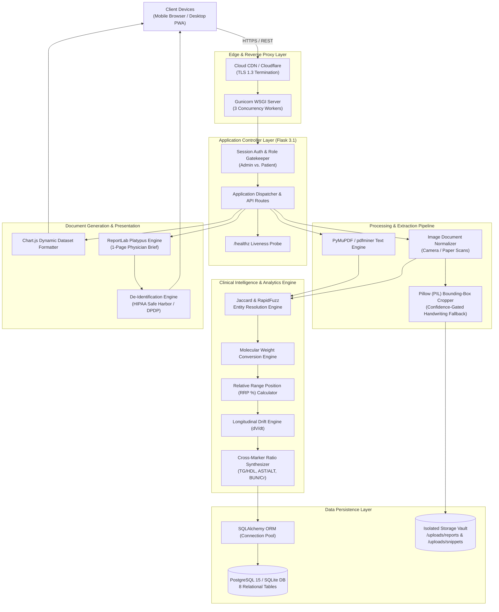
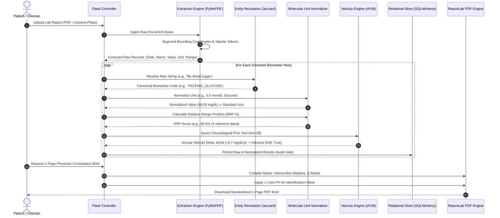
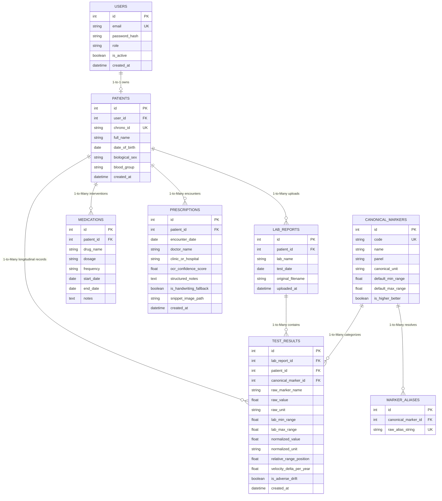
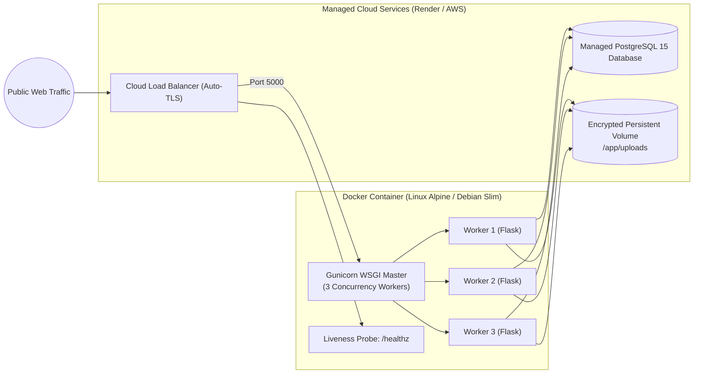

# ChronoLab System Architecture & Engineering Specifications

This document provides a comprehensive technical overview of **ChronoLab**'s system architecture, data ingestion pipelines, entity resolution mechanisms, mathematical normalization models, database schemas, and cloud deployment topology.

---

## 1. High-Level System Architecture

ChronoLab is built on a **modular 5-tier architecture** following 12-factor cloud-native application standards:



---

## 2. Ingestion & Normalization Pipeline Flow

The diagnostic ingestion pipeline standardizes unstructured medical inputs through sequential transformation phases:



---

## 3. Mathematical & Algorithmic Models

ChronoLab avoids non-deterministic generative models for clinical calculations, relying entirely on auditable mathematical and statistical standards:

### 3.1. Molecular Weight Unit Conversion
International diagnostic labs report identical analytes in disparate units. ChronoLab computes conversions using specific molecular masses ($M_r$):

* **Fasting Blood Glucose ($M_r = 180.16\text{ g/mol}$):**
  $$\text{Value}_{\text{mg/dL}} = \text{Value}_{\text{mmol/L}} \times 18.016$$

* **Total, HDL, & LDL Cholesterol ($M_r = 386.65\text{ g/mol}$):**
  $$\text{Value}_{\text{mg/dL}} = \text{Value}_{\text{mmol/L}} \times 38.67$$

* **Serum Triglycerides ($M_r \approx 885.7\text{ g/mol}$):**
  $$\text{Value}_{\text{mg/dL}} = \text{Value}_{\text{mmol/L}} \times 88.57$$

* **25-Hydroxy Vitamin D:**
  $$\text{Value}_{\text{ng/mL}} = \text{Value}_{\text{nmol/L}} \times 0.40064$$

* **Serum Creatinine:**
  $$\text{Value}_{\text{mg/dL}} = \frac{\text{Value}_{\mu\text{mol/L}}}{88.4}$$

---

### 3.2. Relative Range Position ($RRP\%$) Normalization
Different equipment manufacturers (Roche, Abbott, Siemens) utilize conflicting biological reference intervals. Raw values alone cause false alarms when patients switch healthcare providers. ChronoLab normalizes readings relative to the reporting lab's reference band:

$$RRP = \left( \frac{\text{Observed Value} - \text{Reference Min}}{\text{Reference Max} - \text{Reference Min}} \right) \times 100\%$$

* **$RRP = 50\%$**: Exactly centered in optimal range.
* **$0\% \le RRP \le 100\%$**: Within normal clinical limits.
* **$RRP > 100\%$**: Clinically elevated above reporting lab's threshold.
* **$RRP < 0\%$**: Clinically depressed below reporting lab's threshold.

---

### 3.3. Annual Biomarker Trajectory Velocity ($dV/dt$)
To expose sub-clinical disease drift before values exceed standard thresholds, ChronoLab evaluates longitudinal rate-of-change:

$$\text{Velocity} = \left( \frac{\text{Value}_{\text{latest}} - \text{Value}_{\text{prior}}}{\Delta t_{\text{days}}} \right) \times 365.25$$

* **Adverse Drift Trigger Examples:**
  - $\Delta \text{Fasting Glucose} \ge +4.0\text{ mg/dL/year} \longrightarrow \textbf{Pre-Diabetic Drift Alert}$
  - $\Delta \text{HbA1c} \ge +0.20\%\text{/year} \longrightarrow \textbf{Metabolic Deterioration Alert}$
  - $\Delta \text{eGFR} \le -3.0\text{ mL/min/1.73m}^2\text{/year} \longrightarrow \textbf{Renal Decline Alert}$

---

### 3.4. Derived Cross-Marker Physiological Ratios
1. **Triglyceride-to-HDL Ratio:**
   $$\text{Ratio} = \frac{\text{Triglycerides}}{\text{HDL}}$$
   - $\text{Ratio} < 2.0$: Optimal
   - $2.0 \le \text{Ratio} \le 3.5$: Borderline
   - $\text{Ratio} > 3.5$: High Risk (Predictor of atherogenic dyslipidemia and insulin resistance)

2. **De Ritis Ratio (AST / ALT):**
   $$\text{Ratio} = \frac{\text{AST (SGOT)}}{\text{ALT (SGPT)}}$$
   - Distinguishes non-alcoholic fatty liver disease (NAFLD, $<1.0$) from alcoholic or acute toxic hepatic injury ($>2.0$).

3. **BUN-to-Creatinine Ratio:**
   $$\text{Ratio} = \frac{\text{Blood Urea Nitrogen}}{\text{Serum Creatinine}}$$
   - Differentiates prerenal azotemia / dehydration ($>20:1$) from intrinsic renal parenchymal decline ($10:1 \text{--} 20:1$).

---

## 4. Entity-Relationship Data Model (ERD)

The database schema is fully normalized into 8 relational tables enforcing foreign key integrity, cascade deletions, and index optimization for time-series lookups:



---

## 5. Security, Privacy, & Healthcare Compliance

| Compliance Requirement | Implementation in ChronoLab |
| :--- | :--- |
| **HIPAA Safe Harbor (§164.514)** | 1-Click PII de-identification replaces Name, Contact, and Geographic data with a pseudonymous `ChronoID` (`CHRN-XXXX-XXXX`) on all external PDF exports. |
| **India DPDP Act 2023** | Strictly avoids raw 12-digit Aadhaar storage. Implements pseudonymous tokenization modeled after the National Health Authority (NHA) ABHA framework. |
| **Zero-Hallucination Fallback** | Enforces a $\ge 95\%$ OCR confidence gate for prescriptions. Ambiguous handwriting is never transcribed; it is cropped as an authentic visual snippet to eliminate medical dosage errors. |
| **OWASP Container Hardening** | Multi-stage Docker container runs under an unprivileged non-root system user (`USER chronouser`, UID 1000). |
| **Denial of Service Prevention** | Enforces `MAX_CONTENT_LENGTH = 16MB` upload limits and coordinate boundary timeouts on PDF parsing. |
| **Session Protection** | Session cookies utilize `HttpOnly`, `SameSite=Lax`, and automated `Secure=True` in production environments. |

---

## 6. Cloud Deployment & Container Topology



---

## 7. CI/CD Pipeline & Quality Assurance

ChronoLab enforces quality through an automated **GitHub Actions CI/CD pipeline** (`.github/workflows/ci.yml`) triggering on all PRs and pushes to `main`:

```
[ Git Push / PR ] 
       │
       ▼
1. Dependency Resolution (Python 3.11/3.14 Cache)
       │
       ▼
2. Automated Unit & Integration Suite (`pytest -v tests/`)
   ├── test_healthz_endpoint              -> Liveness probe returns 200 OK
   ├── test_dashboard_renders             -> View bindings & auth context
   ├── test_pdf_export_pii_masked         -> ReportLab stream generation & masking
   ├── test_biomarker_alias_matching      -> Token Jaccard entity resolution
   ├── test_unit_conversion_math          -> Molecular weight conversion formulas
   ├── test_relative_range_position       -> Statistical RRP % validation
   └── test_derived_ratios_calculation    -> TG/HDL, AST/ALT risk triggers
       │
       ▼
3. Zero-Failure Merge Gate -> Automated Deployment (Render / Docker Registry)
```
